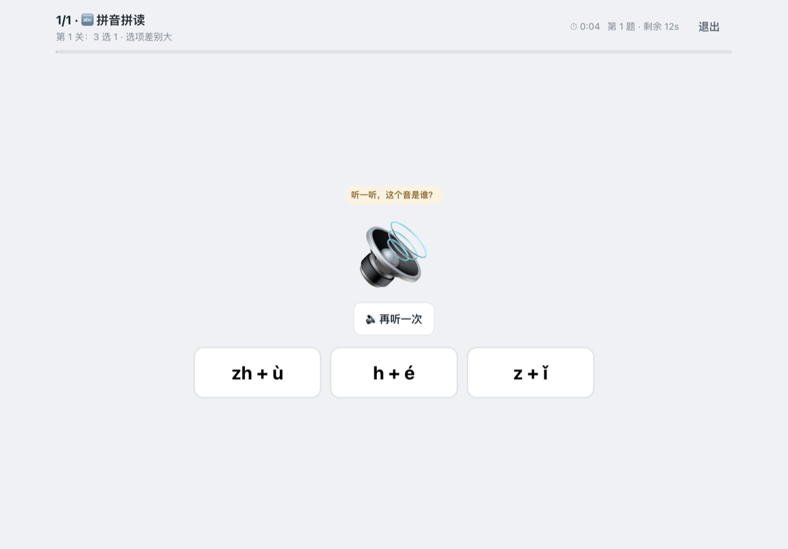
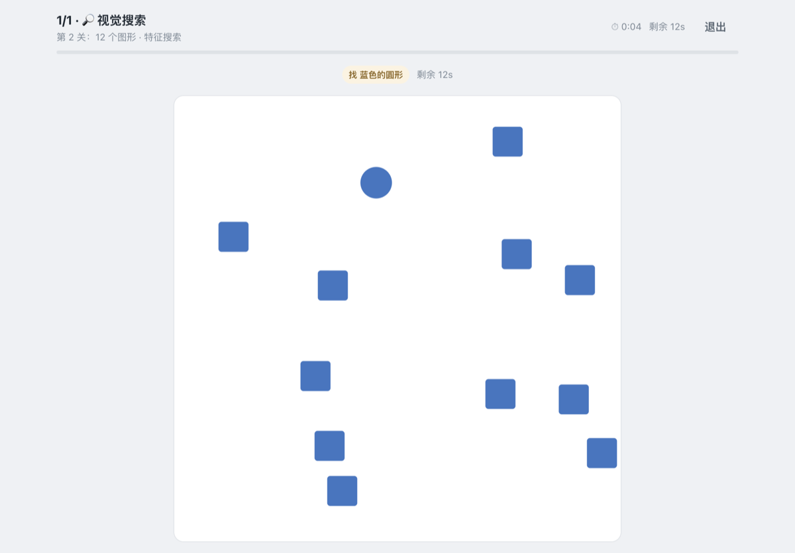
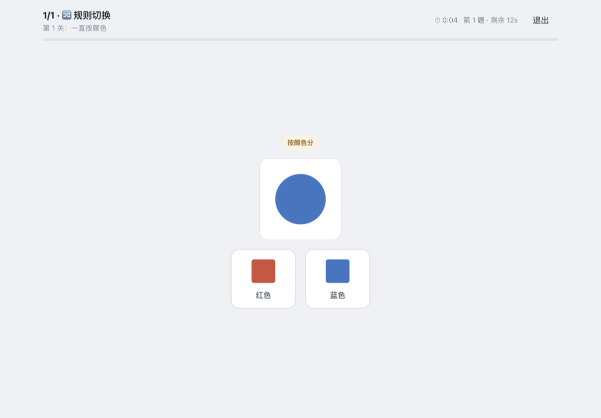

# 专注力训练营

给小学低年级孩子（尤其是**注意缺陷为主型 ADHD / "安静型"**）用的**本地注意力训练**桌面程序。纯离线、不联网、数据只保存在本机。



## 它是什么

- **16 个训练任务**，覆盖 6 个能力维度：持续注意、选择性注意、工作记忆、抑制控制、认知灵活性、语言（拼音拼读）
- 每天自动按维度**随机抽 5 项**（约 13 分钟），带 1 分钟呼吸热身和中间休息
- 每项固定练 **2 分钟**，难度**自适应**（答对加难、答错退一步）
- 记录训练成绩、家长观察（上课/作业专注、情绪、作业时长），生成趋势图和 CSV（可打印给医生或老师）
- 数据实时写入本地文件，每天自动备份；可导出/导入 JSON

| 视觉搜索 | 规则切换 |
|---|---|
|  |  |

## 任务与范式来源

| 任务 | 维度 | 来源范式 |
|---|---|---|
| 舒尔特方格 | 选择性注意 | Schulte Table |
| 划消找字 | 持续注意 | Letter Cancellation / d2（汉字形近字版）|
| 红绿灯 | 抑制控制 | Go/No-Go + SART |
| 树叶方向 | 抑制控制 | Eriksen Flanker（ANT 执行控制成分）|
| 颜色字 | 抑制控制 | Stroop |
| 位置记忆 | 工作记忆 | N-back |
| 方块闪现 | 工作记忆 | Corsi Block-Tapping |
| 听数字 | 工作记忆 | Digit Span |
| 汉字闪记 | 工作记忆 | 正字法工作记忆（中文改编）|
| 听指令 | 工作记忆 | 多步听觉指令（Token Test 路线）|
| 图片辨认 | 工作记忆 | 视觉短时记忆再认（Sternberg 路线）|
| 连点测验 | 认知灵活性 | Trail Making Test A/B |
| 规则切换 | 认知灵活性 | Dimensional Change Card Sort (DCCS) |
| 绿球追踪 | 持续注意 | Multiple Object Tracking (MOT) |
| 视觉搜索 | 选择性注意 | Feature / Conjunction Search |
| 拼音拼读 | 语言 | 语音意识训练 + 拼音两拼法 |

## 下载与安装（macOS）

1. 到 [Releases](../../releases) 下载最新 `.zip`
2. 解压后把 `专注力训练营.app` 拖进「应用程序」
3. 首次打开：**右键 App →「打开」→ 再点「打开」**（未签名应用需要一次确认）

> 目前只提供 Apple Silicon（arm64）构建。Intel Mac 需要自行打包。

## 本地开发

```bash
npm install
npm start        # 开发模式运行
npm run dist     # 打包到 dist/
```

无任何运行时依赖，不需要联网。

## 数据与隐私

- 所有训练数据只保存在本机：macOS 为 `~/Library/Application Support/专注力训练营/`
- 程序**不联网、不上传任何数据**，语音朗读使用系统自带语音
- 清除缓存、更新程序、重装都不会丢数据；建议定期导出 JSON 备份

## 关于效果，必须说清楚

- **近迁移可靠**：练什么，什么就会变好。
- **远迁移有限**：工作记忆训练对课堂表现和学业成绩的改善，多项荟萃分析结论并不乐观。任何"练注意力就能提分"的说法都要打折扣。
- 对 ADHD，证据更强的干预是：**行为管理与家长训练、学校端支持、规律作息与运动，以及在医生评估下的必要药物治疗**。本程序是配菜，不是主线。
- **本程序的任何数字都不能作为诊断依据。** 如未做过正式评估，建议先到正规医院的儿童保健科 / 发育行为儿科 / 儿童心理科就诊。

## License

[MIT](LICENSE)
